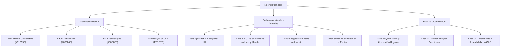
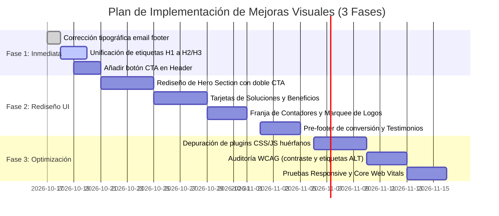

# Plan Estratégico de Mejoras Visuales y UX para NeoAddition

**Sitio web auditado:** [https://neoaddition.com/](https://neoaddition.com/)  
**Fecha de auditoría:** Octubre 2026  
**Especialidad:** Consultoría y Soluciones de Transformación Digital (ServiceNow, Creatio, SMO, Automatización)

---

## 1. Diagnóstico General y Hallazgos Clave

Tras conectarnos e inspeccionar el código fuente HTML, hojas de estilo CSS compiladas de Elementor (`post-5050.css`, `post-5109.css`, `post-18.css`, `post-58.css`), imágenes y scripts activos, se han identificado fortalezas de contenido pero importantes oportunidades de mejora visual, jerárquica y técnica:



### Hallazgos Críticos Encontrados:
1. > [!CAUTION]
   > **Error tipográfico en correo del Footer:** El enlace y texto del footer indica `contacto@neoadittion.com` (con dos 't' en lugar de dos 'd'). Esto genera **rebotes de correos de clientes potenciales** que intenten comunicarse desde la web.
2. > [!WARNING]
   > **Jerarquía de Encabezados Rota (SEO & Accesibilidad):** Existen **cuatro etiquetas `<h1>`** en la página de inicio (`<h1> Inicio`, `<h1> Somos tu Partner...`, `<h1> Te ayudamos a optimizar...`, `<h1> Testimonios`). Según los estándares W3C y Google Search, debe existir exactamente un único `<h1>` semántico por página.
3. > [!NOTE]
   > **Sobrecarga de Librerías y Scripts:** El sitio carga simultáneamente más de 6 complementos de Elementor (*ElementsKit*, *Jeg Elementor Kit*, *HT Mega*, *Gum Addon*, *OoohBoi Steroids*, *MetForm*), inyectando 25+ hojas de estilo CSS y 4 fuentes web distintas (*Roboto*, *Lato*, *Poppins*, *DM Sans*), ralentizando el *First Contentful Paint* (FCP).

---

## 2. Sistema de Diseño y Paleta de Colores Existente

Se preserva íntegramente la paleta de identidad cromática extraída del Kit Global de Elementor (`elementor-kit-5050`):

| Color | Código HEX | Rol Semántico en la Interfaz | Ejemplo de Uso |
| :--- | :--- | :--- | :--- |
| **Azul Marino Principal** | `#01055E` | Color corporativo de marca, solidez y liderazgo | Encabezados principales, barras de navegación, botones primarios |
| **Azul Medianoche Profundo** | `#090246` / `#010441` | Fondo oscuro tecnológico | Fondo de sección Hero, Footer y franjas de contraste |
| **Cian Eléctrico / Neón** | `#00E8F8` | Acento vibrante y moderno de innovación | Botones de llamada a la acción (CTA), estados hover, halos de luz (*glow*), badges destacados |
| **Celeste Pastel** | `#A5E0F9` | Acento secundario y soporte | Bordes sutiles de tarjetas (*cards*), chips de categorías, iconos secundarios |
| **Naranja Melocotón** | `#FFBC7D` | Acento complementario cálido | Resaltado de alianzas clave (Creatio), micro-badges de casos de éxito |
| **Blanco Puro** | `#FFFFFF` | Contraste de luz y limpieza | Fondo de tarjetas sobre fondos claros, textos sobre azul marino |
| **Gris Niebla / Perla** | `#F5F5F5` / `#ECECEC` | Fondos de descanso y alternancia | Fondo de secciones alternadas para romper la monotonía visual |
| **Gris Carbón / Texto** | `#555555` | Legibilidad de párrafos corporativos | Párrafos de lectura, descripciones y notas al pie |

### Tipografía Recomendada (Unificación):
* **Titulares (H1, H2, H3):** *Roboto* o *Poppins* en pesos `600` (Semi-bold) y `700` (Bold).
* **Cuerpo de texto y botones:** *Roboto* o *Lato* en pesos `400` (Regular) y `500` (Medium) con un `line-height` de `1.6` para máxima legibilidad.

---

## 3. Recomendaciones de Mejora Visual Sección por Sección

### A. Cabecera (Header) y Navegación
* **Problema actual:** 8 enlaces horizontales apretados, sin botón de conversión destacado. El dropdown de "Partnership" carece de contexto visual.
* **Mejora:**
  1. **Conversión directa:** Añadir un botón CTA tipo píldora en el extremo derecho: **"Agendar Asesoría"** o **"Contactar Especialista"** con fondo `#00E8F8` y texto `#01055E` en negrita.
  2. **Efecto Glassmorphism / Sticky:** Al hacer scroll, la cabecera debe adoptar un fondo translúcido con desenfoque (`background: rgba(255, 255, 255, 0.92); backdrop-filter: blur(12px); border-bottom: 1px solid #ECECEC`).
  3. **Mega-menú para Servicios/Partners:** Mostrar los logotipos oficiales de ServiceNow y Creatio dentro del menú desplegable para transmitir credibilidad instantánea.

### B. Sección Hero (Primer Pantallazo)
* **Problema actual:** Texto plano sin jerarquía (`Te ayudamos a   optimizar , \nlos procesos...` con puntuación errática) y sin llamada a la acción visible. No hay elemento visual de anclaje (mockup, interfaz o ilustración tecnológica).
* **Mejora:**
  1. **Unificar H1 claro:** 
     * *Pre-título (Kicker):* `[TRANSFORMACIÓN DIGITAL ÁGIL]` con estilo chip en `#00E8F8`.
     * *H1 principal:* `"Optimizamos tus procesos de negocio para impulsar tu crecimiento y productividad"`.
     * *Subtítulo (Párrafo):* `"Diseñamos e implementamos soluciones empresariales escalables con ServiceNow, Creatio y tecnologías Low-Code."`
  2. **Doble CTA de Alto Rendimiento:**
     * Botón Primario: `"Iniciar Diagnóstico"` (Fondo `#00E8F8`, texto `#01055E`, sombra sutil).
     * Botón Secundario: `"Ver Casos de Éxito"` (Outline en `#FFFFFF` sobre fondo `#090246` o botón fantasma con icono de flecha).
  3. **Elemento Visual Tecnológico:** En el lado derecho del Hero, incluir una composición visual que simule un dashboard empresarial con métricas de productividad y flujos automatizados, utilizando los tonos `#01055E`, `#00E8F8` y `#A5E0F9`.

### C. Tarjetas de Pilares de Solución (Estrategia, Digitalización, SMO)
* **Problema actual:** Tres columnas con solo un H3 y un enlace repetitivo `"Ver más"`.
* **Mejora:**
  1. **Arquitectura de Tarjeta Moderna (*Cards*):** Fondo blanco (`#FFFFFF`), bordes redondeados (`border-radius: 16px`), borde sutil (`border: 1px solid #ECECEC`) y sombra al hacer hover (`box-shadow: 0 12px 30px rgba(1, 5, 94, 0.08)`).
  2. **Iconografía SVG con Acento:** Incorporar iconos representativos enmarcados en círculos con fondo cian suave (`rgba(0, 232, 248, 0.12)`).
  3. **Microcopy Descriptivo:** Añadir 2 líneas explicativas a cada tarjeta antes del botón para contextualizar el valor que aporta cada pilar.
  4. **Etiquetado Accionable:** Cambiar el genérico `"Ver más"` por `"Conocer Estrategia →"`, `"Ver Digitalización →"` y `"Explorar SMO →"`.

### D. Sección "Transformación Digital Ágil" (Partnership ServiceNow & Creatio)
* **Problema actual:** Lista de párrafos continuos sin elementos visuales diferenciadores.
* **Mejora:**
  1. **Insignias de Alianza Oficial:** Destacar los logos oficiales de **ServiceNow Partner** y **Creatio Partner** en tarjetas con relieve y badges de certificación.
  2. **Bullets con Iconos de Checklist:** Reemplazar los párrafos planos por una lista interactiva de 4 beneficios clave acompañados de iconos de verificación en color `#00E8F8`.

### E. Franja de Métricas de Impacto (Contadores)
* **Problema actual:** Valores (`7+`, `100+`, `2.5M+`, `200+`) simples que pueden cargar en `0` y carecen de dinamismo visual.
* **Mejora:**
  1. Diseñar una franja en bloque oscuro institucional (`#090246` o `#01055E`) con tipografía de números grandes en `#00E8F8` (`font-size: 3.5rem; font-weight: 700`).
  2. Añadir separadores verticales sutiles en `#A5E0F9` al 20% de opacidad.
  3. Acompañar cada número de una breve etiqueta en `#FFFFFF`:
     * **7+** *Años transformando empresas*
     * **100+** *Proyectos ejecutados con éxito*
     * **2.5M+** *Horas de consultoría e implementación*
     * **200+** *Procesos de negocio digitalizados*

### F. Sección "Por Qué Elegirnos"
* **Problema actual:** Textos concatenados con guiones (`- Mayor satisfacción - Aumento de las ventas...`) y fotografía genérica de stock de apretón de manos.
* **Mejora:**
  1. **Estructura en Píldoras/Chips:** Transformar los guiones en etiquetas estilizadas (*pill tags*) con fondo gris suave (`#F5F5F5`) y texto `#01055E`.
  2. **Sustitución de Imagen:** Reemplazar la fotografía genérica de banco de imágenes (`close-the-deal...webp`) por un gráfico conceptual de arquitectura de soluciones o una foto auténtica del equipo de consultoría de NeoAddition.

### G. Prueba Social: Logotipos de Clientes
* **Problema actual:** Logotipos estáticos con dimensiones desiguales y atributos `alt=""` vacíos.
* **Mejora:**
  1. **Carrusel Infinito (*Logo Marquee*):** Implementar un carrusel suave y continuo que desfile los logotipos de los clientes.
  2. **Tratamiento Gráfico Unificado:** Presentar los logotipos en escala de grises con opacidad al 70%, transicionando a color original en estado `:hover`.
  3. **Accesibilidad:** Asignar atributos `alt="Cliente [Nombre de la Empresa] - NeoAddition"` a cada imagen.

### H. Testimonios de Clientes
* **Problema actual:** Usa etiqueta `<h1>`, formato simple de cita sin comillas de diseño ni fotos de perfiles.
* **Mejora:**
  1. Cambiar la etiqueta a `<h2> Lo que dicen nuestros clientes</h2>`.
  2. Diseñar tarjetas tipo *bento-grid* o carrusel con icono de comillas decorativas en `#00E8F8`, texto de la recomendación en tipografía cursiva/editorial, y en el pie el nombre, cargo y logotipo corporativo de la empresa del cliente (División de Tecnología, COO, Product Owner).

### I. Pie de Página (Footer) y Conversión Final
* **Problema actual:** Error en el correo (`neoadittion`), enlaces dispersos y sin llamada a la acción final antes de terminar la navegación.
* **Mejora:**
  1. **Pre-Footer CTA:** Franja interactiva con el lema: *"¿Listo para acelerar la transformación digital de tu empresa?"* con botón para agendar reunión de 15 minutos.
  2. **Corrección de Datos de Contacto:** Rectificar inmediatamente a `contacto@neoaddition.com`.
  3. **Organización en 4 Columnas:**
     * Columna 1: Logotipo NeoAddition en blanco, descripción corporativa y enlaces a redes sociales (LinkedIn, Medium, Facebook).
     * Columna 2: Enlaces rápidos a Servicios y Soluciones.
     * Columna 3: Sedes Internacionales con micro-iconos (Querétaro 🇲🇽, Vancouver 🇨🇦, Miami Beach 🇺🇸).
     * Columna 4: Suscripción a insights/newsletter de innovación y enlace directo a WhatsApp/Calendly.

---

## 4. Comparativa Visual: Antes vs. Después (Concepto de Maquetación)

````carousel
```html
<!-- ANTES: Sección de Beneficios con texto plano y guiones -->
<div class="elementor-widget-container">
  <h3>Experiencia del cliente</h3>
  <p>- Mayor satisfacción - Aumento de las ventas - Rapidez de ejecución</p>
  <h3>Excelencia operacional</h3>
  <p>- Mejora en la productividad - Mayor colaboración cross-areas - Rapidez en la toma de decisiones</p>
</div>
```
<!-- slide -->
```html
<!-- DESPUÉS: Tarjetas interactivas con sistema de diseño NeoAddition -->
<div class="grid grid-cols-1 md:grid-cols-3 gap-6">
  <div class="bg-white p-6 rounded-2xl border border-[#ECECEC] hover:shadow-xl transition-all">
    <div class="w-12 h-12 rounded-xl bg-[#00E8F8]/10 flex items-center justify-center text-[#01055E] mb-4">
      <svg class="w-6 h-6" fill="none" stroke="currentColor" stroke-width="2" viewBox="0 0 24 24"><path d="M13 10V3L4 14h7v7l9-11h-7z"/></svg>
    </div>
    <h3 class="text-xl font-bold text-[#01055E] mb-3">Experiencia del Cliente</h3>
    <ul class="space-y-2 text-[#555555]">
      <li class="flex items-center gap-2">
        <span class="w-2 h-2 rounded-full bg-[#00E8F8]"></span> Mayor satisfacción de usuarios
      </li>
      <li class="flex items-center gap-2">
        <span class="w-2 h-2 rounded-full bg-[#00E8F8]"></span> Aumento tangible en ventas
      </li>
      <li class="flex items-center gap-2">
        <span class="w-2 h-2 rounded-full bg-[#00E8F8]"></span> Reducción en tiempos de respuesta
      </li>
    </ul>
  </div>
</div>
```
````

---

## 5. Plan de Acción y Cronograma de Ejecución



### Detalle de las Fases de Trabajo:

#### **Fase 1: Correcciones Críticas y Quick Wins (Semana 1)**
* [ ] **Corregir inmediatamente el correo:** Modificar en el footer y enlaces `mailto:` de `neoadittion.com` a `contacto@neoaddition.com`.
* [ ] **Normalizar la jerarquía semántica:** Conservar un solo `<h1>` en el Hero y transformar los demás a `<h2>` o `<h3>`.
* [ ] **Insertar el botón CTA en el menú de navegación:** Configurar botón con fondo `#00E8F8` y tipografía `#01055E`.
* [ ] **Limpieza de textos:** Corregir espacios y signos de puntuación huérfanos en los subtítulos del Hero.

#### **Fase 2: Rediseño Visual y Experiencia de Usuario (Semanas 2 y 3)**
* [ ] **Construir el nuevo bloque Hero:** Implementar estructura de 2 columnas (propuesta de valor + doble botón a la izquierda; mockup/gráfico tecnológico representativo a la derecha).
* [ ] **Modernizar las tarjetas de servicios:** Agregar descripciones de 2 líneas, microcopy orientado a la acción en los botones y estados hover interactivos.
* [ ] **Rediseñar los pilares de "Por qué elegirnos":** Sustituir los guiones de texto por tarjetas con checkmarks y micro-insignias.
* [ ] **Optimizar la prueba social:**
  * Implementar carrusel continuo para los logos de clientes con filtro de escala de grises.
  * Añadir comillas y credenciales de empresa en la sección de testimonios.
* [ ] **Diseñar el Pre-Footer de contacto rápido:** Incluir acceso directo a agendamiento en línea (Calendly o Hubspot).

#### **Fase 3: Optimización Técnica, Accesibilidad y Rendimiento (Semana 4)**
* [ ] **Depuración de hojas de estilo:** Desactivar complementos redundantes de Elementor (*OoohBoi Steroids*, *Gum Addon*, etc.) y consolidar los estilos en el tema hijo para reducir peticiones HTTP de 55+ a menos de 20.
* [ ] **Accesibilidad WCAG 2.1 AA:** Garantizar que los botones y enlaces cumplan con el ratio de contraste mínimo de `4.5:1` y que todas las imágenes cuenten con texto alternativo (`alt`).
* [ ] **Pruebas Responsivas:** Verificar la correcta visualización en breakpoints móviles (360px, 390px, 414px) y tablets (768px, 1024px).
